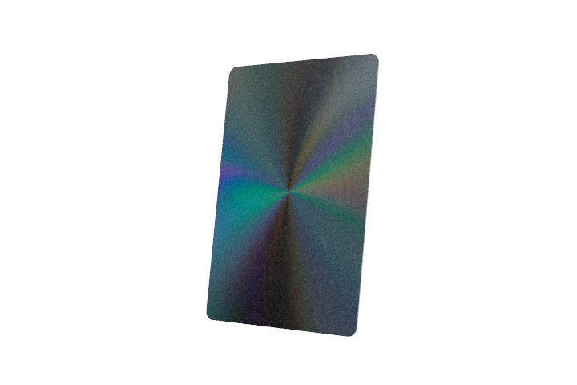
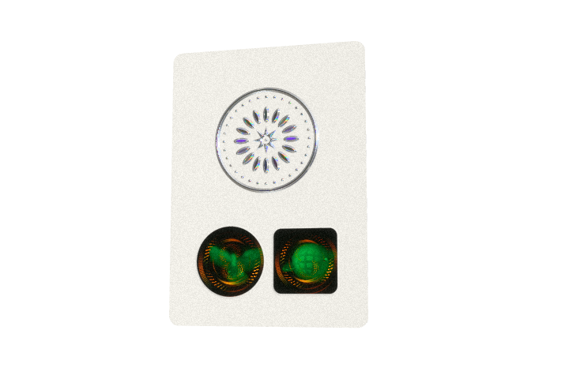
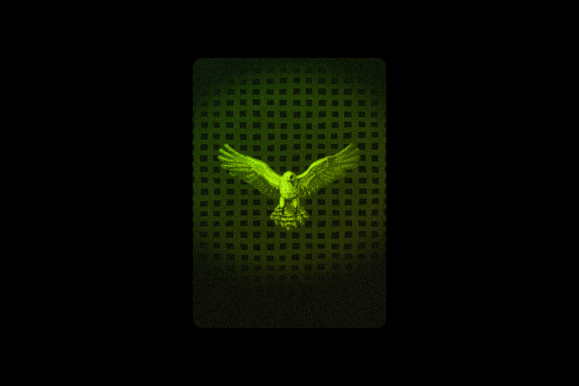
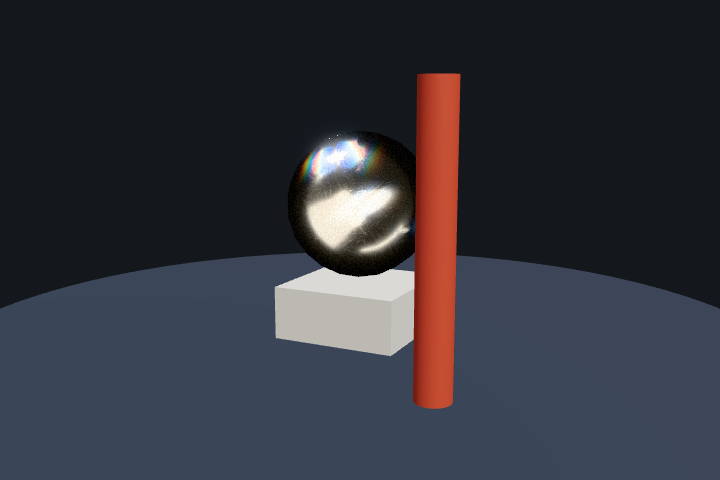
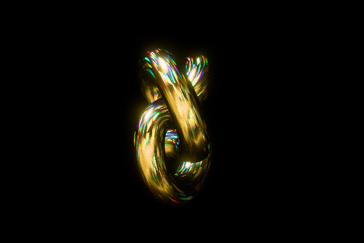
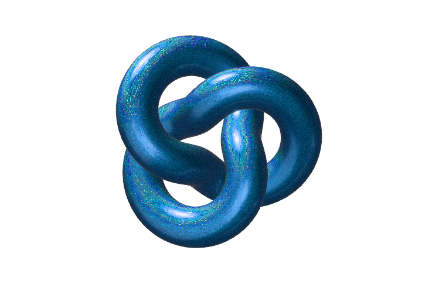

# holospot

The holographic materials of [holo.spot](https://www.holo.spot) for your own three.js scenes: rainbow diffraction foil, cracked-ice foil, holographic glitter, sparkle film, kinetic spirals, volume holograms with a 3D image inside, and foil-embossed paper cards with hologram stickers.

| | | |
|---|---|---|
|  |  |  |
|  |  |  |

These pictures are the pages in `recipes/`, rendered by `tools/shot.mjs` without a GPU. In a browser they move.

It is made to be handed to an AI agent. Give Claude, ChatGPT or another agent this repository and say what you want:

> Look at this repo and make the statue in my scene holographic.

> Use these materials to build a spinning holographic card and render a 6 second video of it.

The agent reads [AGENTS.md](AGENTS.md), which is the whole manual on one page.

## What you get

```js
import { Holo } from "holospot";

const holo = new Holo(renderer);
holo.apply(mesh, { material: "nebula", sizeMm: 120 });
renderer.setAnimationLoop(() => holo.render(scene, camera));
```

- **The same picture as holo.spot.** The kit runs the site's own rendering engine, copied unchanged into `engine/`, and a check (`tools/parity.mjs`) compares the kit's picture with the site's pixel by pixel.
- **Works in the scene you already have.** Your other objects, lights and background are drawn by your renderer as before; the holographic object is composited in, hidden where your objects are in front.
- **Looks designed on holo.spot.** Tune a look on the site, press Copy settings, and pass the copied JSON to the kit.
- **Stills and video.** `tools/shot.mjs` and `tools/render-video.mjs` render pages in headless Chrome, so an agent can look at its result and deliver a clip.

## Try it

```
npm install
npx vite          # then open http://localhost:5173/recipes/apply-to-mesh.html
```

The pages in `recipes/` are complete examples: an object, an object inside an ordinary scene, a GLB model, a tilting card, a paper card with a foil logo and hologram stickers, a hologram, a transparent canvas over a web page, a look pasted from holo.spot, and a video turntable.

## Why it looks real

Colour is not painted on. Each pixel solves the grating equation for the surface's microstructure and integrates the diffracted light against the spectrum of every lamp, so the rainbow moves the way a real foil's does when it tilts. Glints come from individual flakes and facets; a volume hologram replays a recorded 3D object. [docs/how-it-works.md](docs/how-it-works.md) explains the model in plain terms.

## In the repository

| | |
|---|---|
| [AGENTS.md](AGENTS.md) | The manual, for agents and people |
| `dist/holo.js` | The built kit (one ES module; needs three.js r170+) |
| `assets/` | Bump maps, hologram subjects and sample logos |
| `recipes/` | Complete pages to copy |
| `docs/` | One page per material, scene settings, how it works |
| `presets/` | The looks holo.spot ships |
| `tools/` | Screenshots, video, hologram baking, the parity check |
| `src/`, `engine/` | The kit's code, and holo.spot's engine (unchanged) |

## Limits of this version

The holographic object is lit by the kit's own studio lights, not by your scene's lights. It needs `THREE.WebGLRenderer` (WebGL 2), not the WebGPU renderer. holo.spot's ready-made scenes (cloth, flag, sticker wall) are not included; the materials they use are. The full list is in [AGENTS.md](AGENTS.md).

## Licence

MIT. See [LICENSE](LICENSE). The engine is extracted from [holo.spot](https://www.holo.spot).
